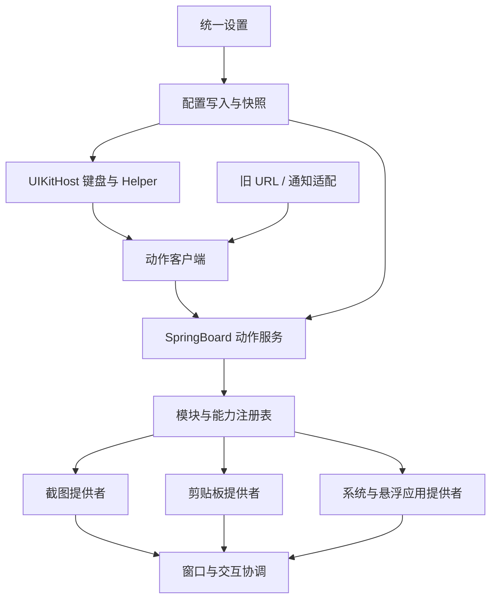

# 03 · 运行架构与接口契约

本章所有 `MT*` 为目标设计，尚未实现。命名、接口和数据字段在 M0 固定后，修改必须更新 ADR 与调用者。

## 1. 工程与安装目标

```text
Metis/
  AGENTS.md / DEVELOPMENT.md / control / Makefile / build.sh
  Core/                       # 共享模型、配置客户端、协议、路径、日志
  Runtime/
    SpringBoard/              # 启动、提供者注册、动作服务、窗口协调
    UIKitHost/                # TypeX 与 Kayoko Helper 的统一 hook 所有者
    PasteServices/            # druid/pasted 的最小可选 hook
  Modules/
    Capture/                  # PixPin 迁入，保留 PX 前缀
    Keyboard/                 # TypeX 迁入，保留 DX 前缀
    Clipboard/                # KayokoX 迁入，保留 Kayoko 前缀
  Preferences/
    Shell/ Search/ Pages/ Editors/ Resources/
  Tools/Migration/            # 数据复制/校验；不默认携带旧提权工具
  Tests/Host/ Fixtures/ Package/
  layout/                    # 安装脚本和只读资源
  docs/development/           # 本设计，必须 Git 跟踪
  docs/implementation/        # 任务状态、来源、功能对照、验收证据
  packages/ios16|ios17/        # 产物，不入 Git
```

| 目标 | 注入/加载宿主 | 内容 | 明确排除 |
| --- | --- | --- | --- |
| MetisSpringBoard.dylib | 仅 SpringBoard | PixPin、TypeX 系统能力、Kayoko Core、主 registry/broker/coordinator | UIKitHost 的重复 hook 安装 |
| MetisUIKit.dylib | 必要 UIKit App/键盘扩展，运行时再分类 | TypeX 键盘、Kayoko Helper、协议客户端 | 截图引擎、历史 SQLite、悬浮 App 托管 |
| MetisPasteServices.dylib | 仅 druid/pasted | 用户启用时的粘贴提示兼容 hook | 历史库、面板、UIKit 初始化 |
| MetisPrefs.bundle | 系统 Preferences | 一个入口，统一设置、搜索、编辑器、迁移 UI | SpringBoard constructor、运行时窗口 |
| MetisCore.dylib | 以上目标作为链接依赖加载 | 公共类型、配置客户端、消息编解码、路径 | 注入 filter、自启业务服务、UI 单例 |

MetisCore 作为私有依赖安装到包内明确路径，所有 Mach-O 使用一致 install_name / rpath；这是构建任务的一部分，不假设系统已有该库。若最终选择静态公共 C helpers，只有无 Objective-C 类的纯函数可重复编译。任何公共 ObjC 类不能在一个进程的两个 image 各定义一份。

MetisUIKit filter 不包含 SpringBoard；即使 filter 版本不支持排除，也必须在 constructor 进程分类后立即 return。还需构建检查证明每个目标唯一持有类实现。Preferences 内的预览只链接 Core 和纯布局模型，不链接完整业务目标。

包建议 ID `com.lindo.metis`，版本从 `0.1.0` 起；旧包名不是新模块名。支持范围定为 iOS 16.x/17.x RootHide，arm64/arm64e；这是目标范围，具体系统/设备支持以验证矩阵为准。

## 2. 依赖方向



模块只依赖 Core 接口；不能直接 import 另一个模块的具体类。迁移阶段可在 `Adapters/Legacy` 内暂时桥接，必须带任务 ID 和删除条件。

## 3. 生命周期与关闭语义

模块状态：`unavailable / disabled / waitingForLaunch / starting / ready / stopping / failed`。用户 enabled、能力可用、当前运行状态三个字段独立。

```objc
// 目标协议示意；实现时补齐类型、nullability 和线程注解。
@protocol MTModule <NSObject>
@property(nonatomic, readonly) NSString *moduleID; // capture / keyboard / clipboard
- (void)prepareWithContext:(MTProcessContext *)context;
- (void)activateWithConfig:(MTConfigSnapshot *)config completion:(MTModuleReply)reply;
- (void)applyConfig:(MTConfigSnapshot *)config;
- (void)deactivateWithReason:(NSString *)reason completion:(dispatch_block_t)done;
@end
```

- constructor 只分类进程、注册最小 hook/启动观察者、读取非敏感启动门控；`+load` 也要审查。不能在这里访问锁屏、Scene 托管等需启动完成的私有 singleton。
- SpringBoard 只有进入已完成启动状态后才 activate；晚加载需能识别已经完成启动；挂一个通知不等于处理了晚加载。
- 所有 UI、状态机推进与窗口操作在主线程，图像/数据库工作在自己的串行队列，绝不跨异步边界持锁。
- deactivate 幂等：停止采集/计时器/观察者、释放手势租约、取消未执行请求、回收窗口、失效 focus token；异步旧回调以 generation/session 拒绝。
- 已发出的相册写入等不可撤回副作用只完成清理，不谎报已撤销；关闭后不再启动新的副作用。
- 为热启停安装的 hook 始终检查总/模块/功能门控并正确调用原实现。需要构造期安装的 hook 标记需重启；不能因为没装 hook 就报“热启用成功”。
- 模块关闭不会动态卸载 dylib，也不保证把私有托管状态自动完整回滚；悬浮 App 关闭模块前必须按已定义策略最小化/释放宿主，不擅自杀用户 App。

## 4. 配置：唯一写入者与版本化快照

新配置权威域：`com.lindo.metis`。v1 Settings 配置服务是唯一配置写入者，迁移/恢复也经同一服务串行提交。运行端的把手位置、悬浮位置、MRU、最后选区等会话状态进入独立 state store，由对应模块写入，禁止混进配置提交造成互相覆盖。

建议键路径：`global.enabled`、`modules.capture.enabled`、`modules.keyboard.enabled`、`modules.clipboard.enabled`、`keyboard.toolbar.top.*`、`clipboard.capture.*`、`integration.*`。只有 schema 目录可声明默认值，不允许 UI、broker、模块各有一套不同默认。

```json
{
  "schemaVersion": 1,
  "generation": 42,
  "writerVersion": "0.1.0",
  "global": {"enabled": true},
  "modules": {
    "capture": {"enabled": false},
    "keyboard": {"enabled": false},
    "clipboard": {"enabled": false}
  },
  "actions": [], "bindings": [], "applicationRules": [],
  "integration": {"captureToHistory": false, "otpToHistory": false}
}
```

实现可以物理拆分配置文件，但一次发布的 generation 必须引用完整一致版本，不能读到“新绑定 + 旧动作”。配置快照与历史数据库不共用事务。

提交流程：读当前 generation → 校验修改和 expectedGeneration → 暂存完整配置与资源引用 → 验证 → 提交权威值 → 原子发布只读公共快照 → 发 `com.lindo.metis/config-changed` → runtime 读取并回执。并发修改 generation 不匹配要重读/合并，不做最后写入静默覆盖。

公共快照逻辑位置 `/Library/Metis/Config/public.plist`，路径经 RootHide 解析。跨沙盒能否读取、写入者能否原子替换必须在 M0 小原型验证；不能仅设置 POSIX 权限就假设沙盒放行。公共目录只容纳必要的非敏感执行配置，不包含历史、请求正文、图片、API key。**不继承 TypeX 0777 共享可写目录作为新权威源。**

公共目录权限要求目标为可读不可由普通客户端写（如 0755/0644，实际所有者与 entitlement 在 M0 验证）；受限配置/凭据放 private store（如 mobile 0700/0600），普通键盘/应用端只获得执行所需字段。AI 网络请求由获准的服务执行，凭据不广播到全部 UIKit hosts。private store 在 Settings 与 SpringBoard 的访问能力同样必须实测；若不可行，先实现受控 broker，不把密钥退回公共快照。

不可读时：首次未建立快照 → 模块保持 waiting/disabled；已有有效快照 → 保留最后有效非敏感配置并报告 degraded；总/模块开关到达关闭必须覆盖缓存并失效业务。未知新 schema 拒绝加载并提示升级，不能用空默认覆盖它。

公共快照不是认证边界：敏感系统操作仍由 SpringBoard 重查权威配置、上下文和用户确认。generation、UUID、Darwin 通知名称均不能证明调用者可信。

## 5. 模块与能力注册表

`MTModuleRegistry` 保存 buildIncluded、configuredEnabled、runtimeState、capabilities、failureReason。每个进程是自己的 registry；跨进程状态通过结构化回执/版本快照传递，不假设一个全局 singleton 贯穿所有进程。

能力 ID 示例：`capture.area`、`capture.editor`、`clipboard.panel`、`clipboard.history.write`、`keyboard.insertText`、`system.openApp`、`floatingApp.host`。内部可用性查询不再扫描 `PixPin.dylib` 或 Kayoko 前缀。

设置选择器区分“已包含但关闭 / 正在启动 / 不支持当前上下文 / 运行失败”。模块不可用时旧引用保留并灰显，不能直接从动作目录消失导致编辑时丢配置。

## 6. 动作与请求协议

```json
{
  "id": "action:uuid",
  "type": "capture.area",
  "title": "区域截图",
  "provider": "capture",
  "inputTypes": ["none"],
  "requires": ["unlocked"],
  "parameters": {},
  "schemaVersion": 1
}
```

内置动作用固定 ID（如 `builtin:capture.area`），自定义 UUID，绑定只保存 ID。迁移 legacy selector 通过白名单目录映射，不让普通输入任意 selector 成为代码调用。

请求字段：`protocolVersion, requestID, actionID, source, configGeneration, createdAt, ttl, contextToken, inputHandle?`。`source` 用于诊断和策略，不能信任调用者自称“Settings”。文本/图片不是 Darwin payload；大图使用受控临时句柄，不传任意文件路径。

状态至少：`accepted, running, succeeded, failed, cancelled, busy, disabled, unavailable, invalid, expired, timedOut, outcomeUnknown`。`accepted` 仅表示接收，截图必须等实际输出结果才能 succeeded。兼容旧无回执通知只返回“已投递”，不映射为功能成功。

- SpringBoard 是系统能力动作执行点，键盘文字动作在原输入宿主执行；不能把 UIResponder 指针跨进程传递。
- 服务端查当前权威动作定义和模块开关，不信任请求里伪造的参数配置；高风险系统操作要运行时用户确认，外部入口不允许任意敏感 URL/关机等权限动作。
- 用 requestID 去重；同一 ID 相同内容重复请求返回原状态，不重复执行；相同 ID 不同内容返回 invalid。
- 超时意味着结果未知，不自动重试有副作用的动作。主动重试使用新的 ID，并要求原动作/副作用允许。
- TTL 判断使用适合当前进程/启动会话的时间基准；跨进程使用可比较的启动时钟标记，不仅依赖可调整的墙上时间。
- 回调在主队列，带请求/session/generation。配置失效、旧焦点、任务取消后不得写入错误会话。

首选复用 TypeX 现有 `DXDarwinOpenChannel` 的编解码与超时经验做适配，但**其可见请求通道不等于鉴权**。M0 必须验证 RootHide App/appex ↔ SpringBoard 的实际通道与 payload 容量。需要敏感数据与调用者身份的接口必须有审计后的身份/授权手段；未实现时限制为已配置白名单动作，禁止开放任意路径、脚本、URL 的特权执行。

对外 `metis://capture/*`、`metis://clipboard/open|close|toggle` 只映射公开动作白名单。URL handler 需要在原宿主链路实际接入，拒绝 query/fragment 中的任意 payload，且总/模块开关和锁屏策略一致。

## 7. 手势、窗口与输入协调

### 7.1 MTGestureCoordinator

一个 surface 一个 hook/识别器所有者。TypeX 与 Kayoko 同时涉及 UIKeyboardDockView、地球/听写、上滑时，不得各装一套互抢。先登记旧 hook 表（类/selector/进程/返回值/原调用语义），再决定合并到 UIKitHost 还是建立明确的 recognizer failure dependency。

触发上下文包括 App、键盘可见、锁屏、方向、当前 modal 会话。未绑定/关闭/失败必须保留原行为。旧手势 threshold、取消与原系统手势并存关系是验收的一部分。

### 7.2 MTOverlayCoordinator

不是一开始重写全部窗口，而是给旧窗口发放租约：`overlayID, moduleID, sessionID, role, interactionMode, capturePolicy`，模块继续拥有窗口渲染与布局。

角色：passive preview、keyboard panel、clipboard panel、capture selection、editor、floating app。modal 交互同一时刻只有一个所有者；被挂起模块保存可恢复状态。禁止所有模块都设置最大 windowLevel。

| 发生事件 | 必须行为 |
| --- | --- |
| 打开截图选区/长截图 | 挂起剪贴板面板、悬浮预览与非必要 Metis 浮层；保留既有键盘可见策略 |
| 开始实际捕获 | 获取可恢复的排除租约，确认有效后再抓屏；失败不能产出含自身浮层的“成功”图 |
| 取消/成功/失败/异常/锁屏 | 归还租约，仅恢复同 session、仍允许显示的窗口；原已隐藏的窗口不擅自显示 |
| 剪贴板悬浮预览 | 空白区域 hitTest 返回 nil；不抢 keyWindow；只在小球区域接触摸 |
| 打开悬浮 App | 保留 TypeX 托管/缩放/输入生命周期，不能把另一面板的 keyWindow 抢回 |
| 屏幕关闭/旋转/内存警告 | 失效过期几何/会话；清理临时交互；保留可安全完成的数据 |

捕获排除继续沿用 PixPin 对 capture mask 位的精确保存/恢复，不能恢复整个旧 bitmask 覆盖其他功能的新位。是否让第三方悬浮 App 出现在截图按源行为保持；Metis 自身 chrome 的排除与 App 内容截图不是同一个概念。

输入焦点使用带过期/宿主/session 的 opaque token。弹面板不立刻强制收键盘；粘贴返回前核验原 responder 仍有效且非 secure entry，无效则保留内容、提示手动粘贴。不得自动贴入后来获得焦点的另一个输入框。

## 8. 剪贴板事件与协作去重

`MTClipboardService` 是 Metis 内部写入的唯一入口；外部 App 的系统变化由 Clipboard 模块观察。事件包含 `eventID, writeID?, origin, changeCount, kind, recordPolicy, previewPolicy`，正文通过受控对象/句柄传递。origin 可能为 `externalApp/capture/otp/keyboardPaste/settingsCopy`。

一次内部写入先登记意图和 policy，再写系统剪贴板，成功后把 changeCount 与 writeID 关联；Kayoko 观察者消费时先查关联，不能先记录再异步删除。若观察回调早于提交，在同一串行事件队列短暂等待结算；无法确认归属的窗口内采用保守的不记录策略，并标明可能漏记，不能仅按文本 hash 猜是不是验证码。

- `capture`：复制成功仍独立于“加入历史”；关闭协作时不生成历史和重复预览。
- `otp`：默认复制但不记录、不预览、不传 AI；该 policy 优先于普通采集开关。
- `keyboardPaste`：从历史粘贴回系统剪贴板不再次生成一条同源历史。
- `settingsCopy`：复制 deep link/API 示例不默认污染历史。
- `externalApp`：按用户采集类型、来源 App 与远程同步规则执行；来源不可确定时按保守规则，不伪造 App ID。

Clipboard 模块关闭时内部复制仍可工作；只是没有历史与面板提供者。Capture 关闭也不影响键盘复制。自动协作不能变成三模块互相硬依赖。

## 9. 路径、资源与诊断

`MTPathResolver` 负责逻辑路径到 RootHide 路径，不拼接 `.jbroot` UUID 或硬编码 `/var/jb`。资源通过 provider bundle 查询，修正 Kayoko 内写死 KayokoPreferences.bundle、TypeX 旧图片路径等引用。

公共资源目录、私有历史目录、临时会话目录和可导出备份分开。临时图片使用不可预测 ID、固定根解析、大小/类型/所有者校验，拒绝 traversal 与符号链接逃逸；释放/超时后清理。

日志格式建议 `[Metis][capture][request-short-id] state=… reason=… duration_ms=…`，不写正文或图片。状态页收集 schema/generation、模块/能力状态、最近错误码、待重新打开进程；没有设备回执显示 unknown。诊断导出必须用户点选，默认脱敏，不上传。

## 10. 端到端参考流程

### A. 从键盘调用区域截图

1. 用户点按工具栏绑定 → Keyboard executor 读取 actionID 与当前 config generation，不主动收起键盘。
2. ActionClient 发唯一 requestID → SpringBoard dispatcher 重查模块/能力/锁屏与动作白名单 → 返回 accepted 或具体拒绝。
3. Capture provider 申请 modal/捕获排除租约，挂起必要浮层 → 创建 PXCaptureTask → 用户框选；实时/冻结沿各自模式时序。
4. 用户确认 → Capture 输出 claim → 保存/复制分别处理；复制只调用 ClipboardService，携带 capture origin。
5. ClipboardService 在写入前登记记录策略；历史关闭时系统剪贴板仍写成功，Clipboard observer 不重复记录/弹预览。
6. 实际输出结果回传 dispatcher → 回调调用者；所有出口归还窗口租约。若调用者已消失，仍完成服务端清理，不恢复旧焦点。

### B. 修改底部工具栏按钮

1. Prefs 编辑器保存 action UUID 引用与按钮外观，带 expectedGeneration 提交。
2. 配置服务校验容量、上下文与引用 → 发布完整 generation；失败停留在编辑页。
3. 已在运行的 UIKitHost 读取新快照，检查有效性后更新布局；需要重新装载 hook 的变更进入 pending 状态。
4. 搜索/动作引用位置由同一模型更新。另一个编辑器基于旧 generation 保存时触发重读/冲突处理，不覆盖新按钮。

### C. 总开关关闭

1. 设置成功发布 global.enabled=false，运行端收到新 generation 后先设置统一业务门控。
2. dispatcher 拒绝新请求，所有 provider 依次停采集/手势/计时器/预览；活动任务按可取消性结束。
3. 窗口租约和 focus token 失效，迟到回调只能清理，不再产生新 UI/复制/插入动作。
4. Settings 收到各运行端停止回执；尚未响应的 host 显示未知/待重新打开。不得以一次通知已投递就宣称所有进程都已停止。
