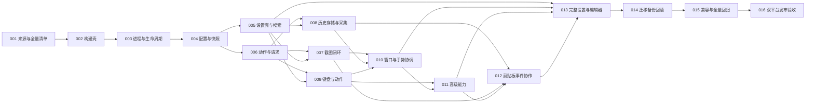

# 06 · 开发任务、依赖与 agent 交接

## 1. 如何使用本手册

后续 agent 先读根 AGENTS.md、DEVELOPMENT.md，再领取一个任务 ID。先交付可编译可检查的切片，完成本地审查后集成；不得一次复制完三个项目再同时修所有错误。

默认由同一执行者按依赖串行推进。只有用户明确要求多 agent 时才分工；以下“责任”表示任务边界，不是现在启动多个 agent 的指令。共享 schema/版本/包目录的写入始终串行。

建议先做 `MT-001 → 002 → 003 → 004 → 005 → 006`，再逐模块推进。一个任务有多个入边时，所有前置都应完成，不表示自动并发执行。



## 2. 任务卡

### MT-001 · 来源固定与功能盘点

- 输入：01、04、evidence、三个源仓库固定 SHA。
- 输出：`docs/implementation/source-provenance.json`、`feature-parity.md`、`legacy-settings-map.json`、`hook-ownership.md`、`license-inventory.md`。
- 工作：按实际类/selector/进程登记全部 hook；扫描动态 Settings 控制器、宏、字符串表和运行 reader，补全不在 plist 的设置；区分 HEAD 与工作区来源。
- 验收：04 所有行组有展开项目；每个 legacy key 有新 path/忽略理由；资源有许可/未知状态；不含私有配置；涉及发布的未知许可有明确解决责任。
- 禁止：把 69 个 plist 行当所有设置；用导入时最新 HEAD 默默替换文档 SHA。

### MT-002 · Metis 构建壳与包契约

- 依赖：001。
- 输出：根 `control/Makefile/build.sh`、Core 空库、三个最小注入目标、Prefs 空壳、`Tests/Package` 检查脚本。
- 工作：实现 07 的本地构建参数、双 SDK 产物、版本锁、目标依赖与 install_name；新旧包冲突关系、许可归档、资源路径。
- 验收：只用 Metis build.sh 构建 iOS 16/17；包一个设置入口；架构、依赖和版本一致；失败不推进版本；不上传/通知/连接设备。
- 风险：源脚本含自动上传与清理旧包，不可原样复制。

### MT-003 · 进程分类与生命周期

- 依赖：002。
- 输出：`MTProcessContext/MTModuleRegistry/MTLifecycleCoordinator`、fake provider 测试。
- 工作：SpringBoard/Preferences/App/keyboard appex/druid/pasted/unsupported 分类；准备、启动、停止、重复调用；晚加载与启动完成门控。
- 验收：构造期不触碰生命周期私有 singleton；关闭不再业务工作；unsupported 进程无 hook；同进程无重复类实现。

### MT-004 · 配置 schema 与公共快照

- 依赖：003；开始前完成 RootHide 路径和读写通道的最小原型。
- 输出：SettingDescriptor/schema、`MTConfigStore/MTConfigSnapshot/MTPathResolver`、generation 提交与 journal、运行端读取客户端。
- 工作：单一写入者、并发 generation 检查、敏感配置隔离、只读公共快照、不可读/损坏/未知 schema、runtime apply policy。
- 验收：首次无配置不自动启用三个模块；旧有效快照不被坏输入覆盖；密钥不出现在公共文件；客户端写入公共快照失败；沙盒可读性标注设备证据状态。
- 不可行处理：记录访问失败并实现受控 broker 原型；不得把目录改 0777 当作完整修复。

### MT-005 · 设置首页、路由与全局搜索

- 依赖：004。
- 输出：唯一入口、模块页壳、搜索索引、设置 route、状态行和 pending restart 模型。
- 工作：按 02 线框实现；关闭模块仍可编辑；搜索结果可跳转高亮；模拟状态与真实运行回执区分。
- 验收：测试输入框和搜索分开；动态动作索引无正文/密钥；深层设置有 stable ID；Light/Dark/字号可读。
- 范围：此卡不实现所有专业模块控制器，交给 013。

### MT-006 · 动作注册、执行与回执

- 依赖：004。
- 输出：`MTActionCatalog/MTActionDispatcher/MTActionClient`、provider 协议、模拟跨进程传输、结果模型。
- 工作：动作 UUID、能力/上下文、TTL、幂等、cancel、busy/disabled、普通输入动作本地执行、系统操作服务端校验。
- 验收：重复 requestID 不重复副作用；超时不自动重试；accepted 与 succeeded 区分；外部请求不能注入任意 selector/文件路径/特权 URL。
- 范围：协议原型验证前不得假设某 IPC 在 RootHide 通用可用。

### MT-007 · Capture 完整迁入

- 依赖：005、006。
- 输出：Modules/Capture、MTCaptureModule、六模式/action provider、编辑器/输出、测试迁入。
- 工作：按 04-PixPin 顺序；窗口先通过最小租约接口登记；实现给 Clipboard 使用的 pinImage/editor 能力。
- 验收：原 host 测试按新路径运行，六模式入口可达；取消/重复/失败和长图内存测试；不再注册独立 PixPin 设置入口。
- 状态：设备能力未验时标 ported/host-verified，不能提前标稳定。

### MT-008 · Clipboard 存储、采集与面板

- 依赖：005、006。
- 输出：Modules/Clipboard、history repository、Helper adapter、面板/预览、临时数据 fixture。
- 工作：先临时数据库后面板，再来源图标、收藏/标签/搜索/富文本/画廊/分词/粘贴；建立业务启停。
- 验收：主库与附件一致；重复变化可控；主面板与预览 hitTest 不混淆；安全输入和旧焦点拒绝；不读取真实历史作为测试 fixture。
- 范围：目标数据库导入入口可以先接受测试源，真实迁移事务在 014 完成。

### MT-009 · Keyboard 核心与动作引用

- 依赖：005、006。
- 输出：Modules/Keyboard 基础工具栏、键盘面板、自定义动作 adapter、UIKitHost hook 所有者。
- 工作：先双工具栏与文字动作，再六槽/子动作/分组/面板/普通系统动作；通过 registry 使用截图与剪贴板能力。
- 验收：顶部/底部容量和原语义不变；没有旧 dylib 探测；marked text/secure entry/无输入上下文边界可控；来源 host tests 记录覆盖类型。

### MT-010 · 窗口、输入与手势统一

- 依赖：007、008、009；后续高级能力必须使用本卡接口。
- 输出：OverlayCoordinator、GestureCoordinator、FocusSession、hook ownership 最终表。
- 工作：截图排除租约、modal 互斥、预览穿透、状态栏/Dock/键盘/Kayoko 激活冲突，独立流程统一归还租约。
- 验收：冲突可视化与保存拦截；同一触发最多执行一次；取消/锁屏/旋转不恢复过期窗口或焦点；不主动改变截图前键盘策略。

### MT-011 · TypeX 高级能力

- 依赖：009、010。
- 输出：悬浮 App/停靠栏/键盘把手、AI、JavaScript、验证码、浏览器重定向、系统控件。
- 工作：保持源子系统边界，凭据隔离与网络明确触发，私有类/签名能力检查。
- 验收：每个功能独立开关；OTP 和重定向默认关；悬浮托管/恢复指标有阶段日志；脚本取消和流式迟到回调测试；关闭模块后不继续采集。
- 不得：用编译成功替代悬浮 App 真实输入/触摸验证。

### MT-012 · 剪贴板协作与敏感写入隔离

- 依赖：007、008、011。
- 输出：MTClipboardService、write intent/commit ledger、origin policy、协作设置。
- 工作：截图复制、OTP、历史粘贴、设置复制都经单入口；外部变化观察与写入事件关联。
- 验收：关闭 captureToHistory 时系统复制成功但历史/预览不重复；OTP 默认不落库/预览；并发外部复制不会仅凭 hash 被错误归类；Clipboard 关闭不影响复制。

### MT-013 · 全部设置页面与统一编辑器

- 依赖：005、010、011、012。
- 输出：02 所有页面、动作/按钮/图标/App 选择器、应用规则矩阵、引用检查、完整搜索目录。
- 工作：专业参数逐项映射 schema，原 controller 可重用但数据写入统一服务；原设置首页退役。
- 验收：settingID 与迁移表一一对照；按 02-10 验收；删除引用不静默替换；数值/隐藏/顺序恢复保持；没有只存在于原项目而新界面无法到达的设置。

### MT-014 · 数据迁移、备份恢复与回滚

- 依赖：013。
- 输出：05 的 importer、journal、归档、预览 UI、回滚工具/指引、旧包卸载脚本审查记录。
- 工作：三域、动作关系、SQLite/附件一致快照、dry-run、两阶段提交、普通/完整备份、恶意归档限制。
- 验收：真实路径由用户选择且当前任务有相应授权；正常测试用匿名 fixture；每个中断点能恢复；二次导入幂等；旧目录哈希不变。

### MT-015 · 旧入口与功能对照收敛

- 依赖：014。
- 输出：pixpin/kayokox/public notify 兼容 adapter、feature-parity 最终表、source/protocol 扫描报告。
- 工作：旧别名单向进入 dispatcher；Snapper/ShellX 可选兼容；检查旧路径/域残留是迁移用还是错误运行依赖。
- 验收：没有内部通知回环；旧入口也服从总/模块门控；功能缺项全部有真实延期决策，不能删掉对应对照行。

### MT-016 · iOS 16/17 验证与发布候选

- 依赖：015，发布许可/依赖问题解决。
- 输出：双平台包、哈希与版本 manifest、07 验收报告、已知限制与回滚指引。
- 工作：在明确集成分支运行项目 build.sh；做包级审查；设备步骤只有用户主动发起时执行，否则待验清单交付。
- 验收：源码/主机/包/设备证据分开；未真机验收只能标 candidate；上传归档必须有发布授权，不能自动套源项目云目录。

## 3. 分支和共享文件

任务起点记录 `integrationBranch / integrationHEAD / taskBranch / taskHEAD / worktreeStatus`。任务依赖以集成分支实际提交为准，不能只说另一项“应该快做完了”。

Core schema、动作协议、根 Makefile/control/build.sh、公共资源目录、迁移格式由实施负责人串行整合。模块任务只改自己的目录与必要 adapter；需要变更公共协议时先写设计 diff，再同步调用者。

本地合入后才生成最终发布包。build.sh 版本写回串行处理，并把版本/manifest 变更纳入本地提交记录；无 push 指令不推送。若两个任务触及相同 hook，先统一 ownership，不能靠 Git 无冲突就认为运行时无冲突。

## 4. agent 启动提示模板

```text
请在 /Users/xiao/dev/github/Metis 执行 MT-XXX。
先读 AGENTS.md、DEVELOPMENT.md 和任务关联章节。
检查真实分支、HEAD、未提交修改与前置任务状态；来源固定到 evidence 中的 SHA。
本次范围：列明输出；本次不包含的后续任务记录在交接中。
按任务验收标准完成实现、审查和必要主机测试，打包仅使用 Metis 的 build.sh。
没有用户当前主动连接请求时，不得 USB/SSH。不要改源项目、push 或自动上传。
产出任务报告，明确源码、主机、包、真机证据，以及未完成项。
```

## 5. 任务报告模板

```text
任务 ID / 状态：
集成分支和基点 / 任务分支与 HEAD：
依赖任务实际提交：
变更文件与行为：
沿用来源与移植差异：
配置/schema/protocol 变化：
执行的检查命令、结果与证据文件：
源码审查：
主机测试：
构建与包检查：
真机验证（机型、OS、用户连接授权、本次步骤）：
未验证/延期/阻塞：
回滚方式：
下一项可执行任务：
```

“任务完成”按本卡交付边界判断；“产品发布”按 07 判断。等待设备验收时可交付完整源码与包，但不能把对应 device-verified 状态标为通过。
